<table width="100%">
  <tr>
    <td width="21%" align="center" valign="middle">
      
    </td>
    <td width="58%" align="center" valign="middle">
      <h1>𝑳𝒆𝒐𝒏𝒓𝒚𝒖𝒖 ♫</h1>
      
<i>Software engineering student in Germany. I build, break, fix, and write it down.</i>

      
Hi, I'm Leonryuu. I like turning ideas into small projects that actually run, and untangling complex problems into clear explanations.

      

        
        
        
      

    </td>
    <td width="21%" align="center" valign="middle">
      
    </td>
  </tr>
</table>

### 👋 About me

- 🎓 Studying software engineering in Germany (HSBI)
- 🧩 Into AI agents, data, full-stack products, computer vision and embedded systems
- ☁️ Running my own cloud server with a self-healing, low-token AI assistant that lives in QQ
- 🔌 Wiring AI into the tools I actually use: MCP servers for QQ, my server and WhatsApp
- 🧪 Turning coursework into tested, documented, reproducible demos
- 🎮 Rhythm-game breaks, anime, and making random ideas real

### 🚀 Recent highlights

| When | What |
|:--|:--|
| **Nov&nbsp;26** | 📦 Delivered **Datenpaket v1.0** for the IPM team: JSON Schema data contract, example + error packages and a one-command checker `pruefe_json.py`, so teammates can validate their JSON without reading the schema |
| **Nov&nbsp;26** | 💬 Self-hosted **[WhatsApp MCP](https://github.com/lharries/whatsapp-mcp)** on Windows (Go bridge with CGO + Python server) so Claude can read my project group chats; found and fixed a bridge bug where out-of-order history batches overwrote a chat's last-active time, and repaired the affected records |
| **Nov&nbsp;22** | ☁️ Built **Cloud Server** from zero: Linux, systemd, cron, SSH, my own MCP server, a self-healing watchdog and an acceptance suite (**26 pass · 0 fail**) |
| **Nov&nbsp;22** | 💸 Cut the bot's per-call context from ~20K tokens to a bounded window and moved every frequent check into **zero-token** code |
| **Nov&nbsp;18** | 🗄️ Finished **Big Data Praktikum 2** (Cassandra + MovieLens) with **54/54 tests** and a mutation test |
| **Nov&nbsp;17** | 🎬 Shipped **AniTrack**, plus turned two older projects into public demos with CI, reports and verification |

### 🛠️ A few things I've made

<table>
  <tr>
    <td width="50%" valign="top">
      <h4>☁️ <a href="https://github.com/leonryuu29/cloud-server">Cloud Server</a></h4>
      A 2-vCPU cloud VM turned into a self-healing AI assistant: AstrBot + DeepSeek + a hand-written <b>MCP server (21 tools)</b>, a zero-token watchdog that re-sends missed pushes, an important-mail doorbell, MCP-over-SSH collaboration with Claude / Codex and a 26-check acceptance script. 10 chapters of docs.
        
      <code>Python</code> <code>FastMCP</code> <code>AstrBot</code> <code>systemd</code> <code>cron</code>
    </td>
    <td width="50%" valign="top">
      <h4>📦 <a href="https://github.com/leonryuu29/ipm-datenerhebung">ipm-datenerhebung</a></h4>
      Data side of an LLM-assisted variant-management prototype (team project): JSON Schema data contract, synthetic ERP data, Excel → CSV/JSON converter and the new <b>Datenpaket v1.0</b> handover. <b>39 tests</b>, including Playwright tests against the team's prototype.
        
      <code>Python</code> <code>JSON Schema</code> <code>pytest</code> <code>Playwright</code>
    </td>
  </tr>
  <tr>
    <td width="50%" valign="top">
      <h4>🎬 <a href="https://github.com/leonryuu29/Anitrack">AniTrack</a></h4>
      Full-stack anime library: bilingual metadata, Berlin-time timetable, activity heatmaps, OpenAPI contracts and 26 automated checks.
        
      <code>Next.js</code> <code>NestJS</code> <code>MongoDB</code> <code>OpenAPI</code>
    </td>
    <td width="50%" valign="top">
      <h4>🗄️ <a href="https://github.com/leonryuu29/Big-Data-Praktikum">Big-Data-Praktikum</a></h4>
      Redis + Yelp and Cassandra + MovieLens: query-driven tables, CQL, autocomplete, a 5-stage test chain, CI and <b>77 passing tests</b> across both practicals.
        
      <code>Redis</code> <code>Cassandra</code> <code>Docker</code> <code>GitHub Actions</code>
    </td>
  </tr>
  <tr>
    <td width="50%" valign="top">
      <h4>🚗 <a href="https://github.com/leonryuu29/yolov3-traffic-counter">YOLOv3 Traffic Counter</a></h4>
      OpenCV DNN + SORT vehicle pipeline with line-crossing counts, speed estimation, tests, a technical paper and reproducible model setup.
        
      <code>OpenCV</code> <code>YOLOv3</code> <code>SORT</code> <code>Python</code>
    </td>
    <td width="50%" valign="top">
      <h4>✨ <a href="https://github.com/leonryuu29/particle-swarm-game">Particle Swarm</a></h4>
      Browser game where force fields steer a 2,145-particle swarm; generated art, bounded effects and a headless Edge smoke test.
        
      <code>JavaScript</code> <code>Phaser 3</code> <code>CI</code>
    </td>
  </tr>
</table>

### 🤖 AI usage

  

Real numbers: Codex from its local thread database · the bot from AstrBot's own stats table (both re-counted 2026-11-27) · Claude from the session's usage meter during the Cloud Server build (a lower bound).

### 💪 Strengths

| | |
|:--|:--|
| **Code** | Python · TypeScript · C# · Java · JavaScript · Go · C · SQL |
| **Web** | Next.js · NestJS · Spring Boot · Vue 3 · REST APIs · OpenAPI · MongoDB · MySQL |
| **Data** | Redis · Cassandra · CQL · data modelling · JSON Schema data contracts · Excel → JSON pipelines |
| **AI & Vision** | OpenCV · YOLO · SORT tracking · LLM prototypes · prompt + data interfaces |
| **AI Agents** | MCP servers (FastMCP) · self-hosted MCP (WhatsApp) · AstrBot · Claude · Codex · tool design · low-token automation |
| **Testing** | pytest · Playwright · Vitest · mutation tests · acceptance scripts · GitHub Actions CI |
| **Cloud & Ops** | Ubuntu server · systemd · cron · SSH tunnels · IMAP · Docker · self-healing watchdog |
| **Embedded** | STM32F103 · STM32CubeMX · HAL · GPIO · I2C · interrupts |

  
  
  
  
  
  
  
  
  
  
  
  
  
  
  
  
  
  
  
  

### 🌍 Languages

| | Language | Level |
|:--|:--|:--|
| 🇨🇳 | **中文** | Native |
| 🇩🇪 | **Deutsch** | C1 (telc) · studying and exams in German |
| 🇬🇧 | **English** | Study & code |
| 🇯🇵 | **日本語** | ちょっとだけ |

  
<strong>Current focus</strong> 🌱

   

  <ul>
    <li>📦 IPM: switching the data pipeline from synthetic to real company data (handover on 04.12.)</li>
    <li>☁️ Keeping my cloud assistant light and self-healing; next up: a weekly pandas report on my music taste and a Docker + Jupyter data workspace on the server</li>
    <li>🎧 <a href="https://live-deutsch-studio.vercel.app/">Live Deutsch Studio</a>: my private live German → Chinese translation studio for phone and PC</li>
    <li>📚 Turning completed coursework into clear demos while getting better at AI, data science, full-stack engineering, German and embedded systems, and keeping everything a little fun</li>
  </ul>

  
   
  <i>小さな一歩でも、毎日進む。</i> 
  One small step at a time. ♡

  Maimai characters © SEGA · Character art via Maimai Wiki · GIF via Tenor

